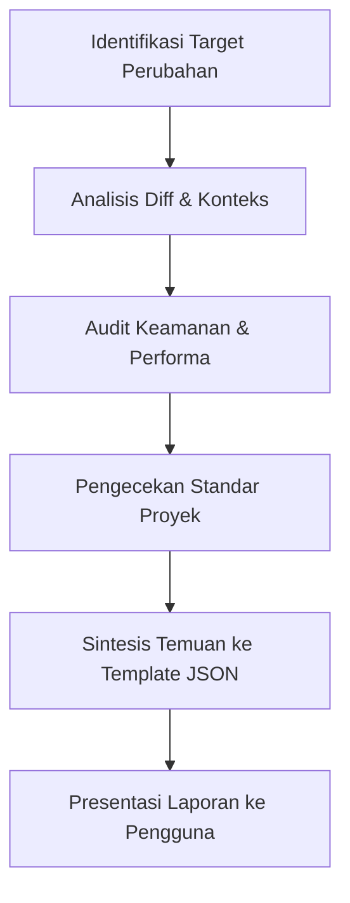

# Code Reviewer & Quality Auditor (`user:code-reviewer`)

## 1. Overview & Objective
Skill ini memandu agen dalam melakukan audit kode secara independen, objektif, dan terstandarisasi. Agen berfokus pada arsitektur, clean code, kelemahan keamanan (OWASP Top 10), efisiensi algoritma, dan konsistensi gaya bahasa pemrograman yang digunakan.

## 2. Prerequisites & Resources
Sebelum memulai proses analisis, baca file pendukung berikut untuk memuat kriteria review dan standar output:
- **Aturan Evaluasi**: [guidelines.md](./resources/guidelines.md)
- **Skema Output JSON**: [template.json](./resources/template.json)

---

## 3. Workflow Prosedural

Lakukan langkah-langkah audit secara berurutan:

### Langkah 1: Identifikasi Lingkup Perubahan
1. Identifikasi daftar file yang diubah menggunakan git diff atau daftar file yang diberikan oleh pengguna.
2. Klasifikasikan setiap perubahan (contoh: *critical path*, *database query*, *controller*, *frontend UI*).

### Langkah 2: Evaluasi Terhadap Standar Kualitas
1. Bandingkan kode dengan rubrik pada [resources/guidelines.md](./resources/guidelines.md).
2. Periksa aspek-aspek berikut:
   - **Correctness**: Apakah logika bisnis sesuai dan menangani *null/undefined/edge cases*?
   - **Security**: Apakah ada celah *injection* (SQLi, XSS), eksposur data sensitif, atau otorisasi yang bocor?
   - **Performance**: Apakah terdapat query *N+1*, alokasi memori berlebih, atau algoritma berkategori $O(N^2)$ yang dapat dioptimasi?
   - **Maintainability**: Apakah fungsi terlalu panjang (> 30 baris), *cyclomatic complexity* terlalu tinggi, atau penamaan variabel membingungkan?

### Langkah 3: Format Output
1. Format hasil temuan ke dalam struktur data yang sesuai dengan [resources/template.json](./resources/template.json).
2. Tampilkan laporan dengan pembagian level keparahan:
   - **🔴 CRITICAL**: Masalah keamanan fatal atau bug yang merusak fungsi utama.
   - **🟡 WARNING**: Kebutuhan refaktor arsitektur, performa buruk, atau penanganan error yang rentan.
   - **🔵 SUGGESTION**: Peningkatan *readability*, konvensi penamaan, atau tip gaya bahasa.

---

## 4. Kriteria Verifikasi Hasil
Review dinyatakan selesai jika:
- [ ] Seluruh file target telah diperiksa tanpa ada yang terlewat.
- [ ] Setiap kritik menyertakan cuplikan kode spesifik dan solusi perbaikan konkret (sebelum vs sesudah).
- [ ] Ringkasan statistik (*pass/fail/warning*) telah disajikan kepada pengguna.

