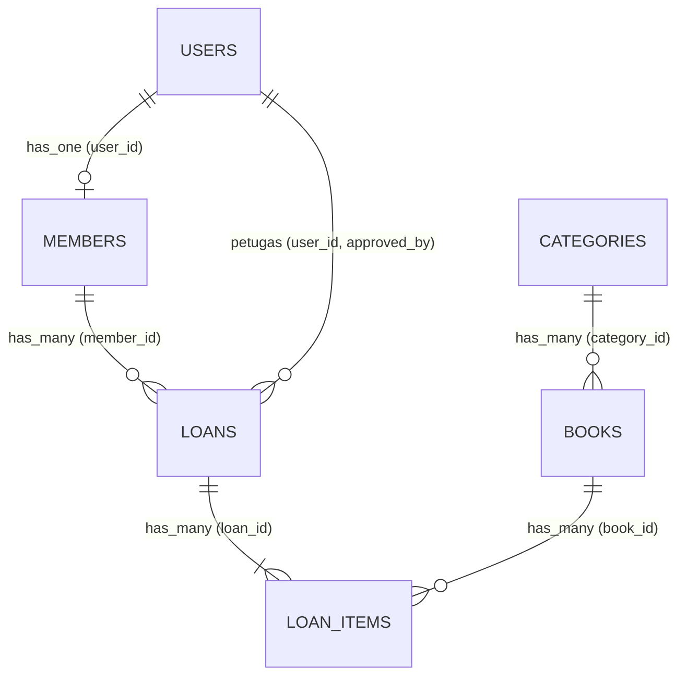

# Dokumen Perancangan: Self-Service Library System

**Final Project UAS — Workshop Pemrograman Framework**
Diperbarui: 17 November 2026 (setelah iterasi stabilisasi)

---

## 1. Ringkasan

Sistem informasi perpustakaan berbasis Laravel 12 dengan antarmuka **Livewire 3 + Tailwind CSS (Vite)**. Aplikasi mendukung peminjaman mandiri mahasiswa, persetujuan dan pengembalian oleh petugas, perhitungan denda, laporan, serta REST API yang juga dikonsumsi oleh halaman web.

Target pengguna:

1. **Anggota / Mahasiswa** — katalog, pengajuan pinjam, pembatalan pengajuan, monitoring status & denda.
2. **Petugas** — kelola buku & anggota, persetujuan/penolakan, pengembalian, input transaksi manual.
3. **Admin** — seluruh akses petugas ditambah manajemen kategori.

---

## 2. Kebutuhan Non-Fungsional

- **Integritas transaksi**: mutasi stok dan perubahan status dibungkus `DB::transaction()` + `lockForUpdate()`.
- **Konsistensi aturan**: seluruh transisi sirkulasi melewati satu service (`App\Services\LoanService`).
- **Keamanan**:
  - RBAC tiga peran lewat middleware `role` dan `admin`.
  - Endpoint API tulis dilindungi header `X-API-Key`; endpoint baca tetap publik.
  - Guard tambahan di komponen Livewire (`mount`) dan validasi route.
- **Ketahanan**: dashboard/laporan memakai HTTP ke API internal dengan timeout dan fallback lokal, sehingga tetap tampil bila server API mati.
- **Kinerja**: pencarian katalog memakai `wire:model.live.debounce.300ms`; index pada `loans.status`.

---

## 3. Arsitektur Data



### Skema utama

| Tabel | Kolom penting | Catatan |
|---|---|---|
| `users` | `role` | `admin`, `petugas`, `anggota` |
| `members` | `user_id` (nullable, `nullOnDelete`) | Satu anggota satu akun login |
| `loans` | `status`, `denda`, `approved_by`, `approved_at`, `tanggal_dikembalikan` | Status: `diajukan`, `dipinjam`, `dikembalikan`, `ditolak` |
| `books` | `stok` | Berkurang saat pengajuan, pulih saat tolak/batal/kembali |
| `loan_items` | `loan_id`, `book_id` | Mendukung multi-buku per transaksi |

Migrasi `2026_11_17_000001_normalize_loan_status_and_index` mengubah data lama `terlambat → dipinjam` dan menambahkan index `loans.status`.

---

## 4. Komponen Antarmuka

```text
app/Livewire/
├── BookCatalog.php   # Katalog + modal pengajuan untuk anggota
├── MyLoans.php       # Riwayat, status, estimasi denda, pembatalan
└── LoanApproval.php  # Setujui / tolak / proses pengembalian (petugas & admin)

app/Http/Controllers/
├── LoanController.php      # CRUD + laporan (konsumsi API)
├── DashboardController.php # Statistik (konsumsi API + fallback)
└── Api/                    # Endpoint REST

resources/views/
├── layouts/app.blade.php   # Layout tunggal (Livewire & Blade)
├── livewire/               # Tampilan komponen
└── books|members|loans|... # Halaman CRUD
```

Modal konfirmasi dikontrol state Livewire (`$showModal`) dengan dukungan tombol **ESC**, `role="dialog"`, dan `aria-modal`. Seluruh halaman memakai layout yang sama.

---

## 5. Logika Transaksi & Aturan Bisnis

### Siklus hidup

```text
Katalog → Diajukan (stok −1) → Dipinjam → Dikembalikan (stok +1, denda final)
                             ↘ Ditolak / Dibatalkan (stok +1)
```

Transaksi manual petugas dibuat langsung `dipinjam` dan memotong stok.

### Aturan

1. Maksimal **3 buku aktif** per anggota (`diajukan` + `dipinjam`).
2. Anti-duplikasi judul yang sama selama masih aktif.
3. Stok dipotong saat pengajuan; dipulihkan saat ditolak, dibatalkan, atau dikembalikan.
4. Denda: `max(0, hari terlambat) × Rp 5.000`, dihitung saat pengembalian. Nilai tidak pernah negatif.
5. Hanya empat status sah; `terlambat` bukan status lagi.
6. Hapus buku/kategori/anggota yang punya riwayat transaksi → ditolak dengan pesan ramah.
7. Hapus transaksi aktif → ditolak.
8. Transisi status divalidasi ulang di dalam lock (`lockedLoan`) agar tidak dobel proses.

### Service

| Service | Tanggung jawab |
|---|---|
| `LoanService` | `submit`, `submitForMember`, `approve`, `reject`, `cancel`, `returnLoan`, `delete`, kuota & stok |
| `LibraryStatsService` | Ringkasan statistik untuk dashboard & `GET /api/stats` |
| `LoanReportService` | Query + payload laporan untuk web & `GET /api/loans` |

---

## 6. Keamanan & Otorisasi

| Area | Mekanisme |
|---|---|
| Halaman web | Middleware `role:admin,petugas`, `role:anggota`, `admin` |
| Komponen Livewire | Guard `mount()` pada `LoanApproval` |
| API baca | Publik (`GET`) |
| API tulis | Middleware `api.key` (`X-API-Key` dari `API_KEY`) |
| Hapus data terpakai | Pengecekan relasi + pesan error |
| Mass assignment | `$fillable` eksplisit pada model |

Matriks akses lengkap ada di `README.md`.

---

## 7. Keputusan Desain (Decision Log)

| # | Keputusan | Alternatif yang ditolak | Alasan |
|---|---|---|---|
| D1 | Stabilkan dulu, rapikan bertahap | Refactor total / demo-only | Risiko demo rendah |
| D2 | Pertahankan pola konsumsi REST API internal | Hapus HTTP internal | Asumsi aman terhadap syarat penilaian |
| D3 | Prioritaskan alur mahasiswa | Panel petugas / dashboard | Halaman paling sering dibuka |
| D4 | Satukan layout + poles visual | Redesign total | Nilai visual naik tanpa risiko besar |
| D5 | Stok dipotong saat diajukan | Potong saat disetujui | Sesuai kode & design awal, perubahan minimal |
| D6 | Satu siklus transaksi, hapus `terlambat` | Pertahankan alur legacy | Menghilangkan inkonsistensi |
| D7 | Admin penuh, petugas operasional (kategori hanya admin) | Petugas setara admin | Least privilege |
| D8 | API tulis pakai API key | Read-only / Sanctum | Aman, tetap mudah didemokan |
| D9 | Migrasi data + seeder idempoten | Reset total | Data & akun demo tidak hilang |
| D10 | SQLite + dua server lokal | MySQL / dua DB | Sesuai kondisi demo |
| D11 | Tanpa fitur baru | Tambah fitur kecil | Fokus & waktu |
| D12 | Definisi selesai: demo + test + dokumen | Demo saja | Kualitas & kesan rapi |

Keputusan teknis turunan:

- **Satu service transaksi** (`LoanService`) untuk semua jalur (Livewire, web, API).
- **Fallback lokal** pada dashboard/laporan, bukan memanggil controller lain secara langsung.
- **Password awal anggota = NIM**, akun dibuat otomatis saat pendaftaran/seeding.
- **Seeder idempoten**: aman dijalankan berulang tanpa menduplikasi data.
- **Aset produksi** (`npm run build`) dipakai saat demo; `public/hot` dihapus.

---

## 8. Pengujian

`php artisan test` mencakup:

- Akses halaman per peran dan redirect guest.
- API key: 401 tanpa/salah, 201 dengan key valid.
- Pengajuan mandiri, kuota 3 buku, anti-duplikasi.
- Persetujuan, penolakan, pembatalan, pengembalian tepat waktu & telat.
- Transaksi manual petugas (status & stok).
- Guard hapus buku/transaksi.

Total: **33 test, 98 assertion** (status: lulus).

---

## 9. Roadmap Implementasi (status)

| Tahap | Status |
|---|---|
| Migrasi skema self-service (`user_id`, `approved_by`, `denda`, status baru) | ✅ |
| Model & relasi Eloquent | ✅ |
| Akun anggota otomatis + password NIM | ✅ |
| Komponen Livewire katalog, pinjaman saya, sirkulasi | ✅ |
| Satukan layout & poles UI | ✅ |
| RBAC + API key | ✅ |
| Sentralisasi logika sirkulasi & denda | ✅ |
| Migrasi data lama + seeder idempoten | ✅ |
| Hardening konsumsi API + fallback | ✅ |
| Test menyeluruh & dokumentasi | ✅ |
