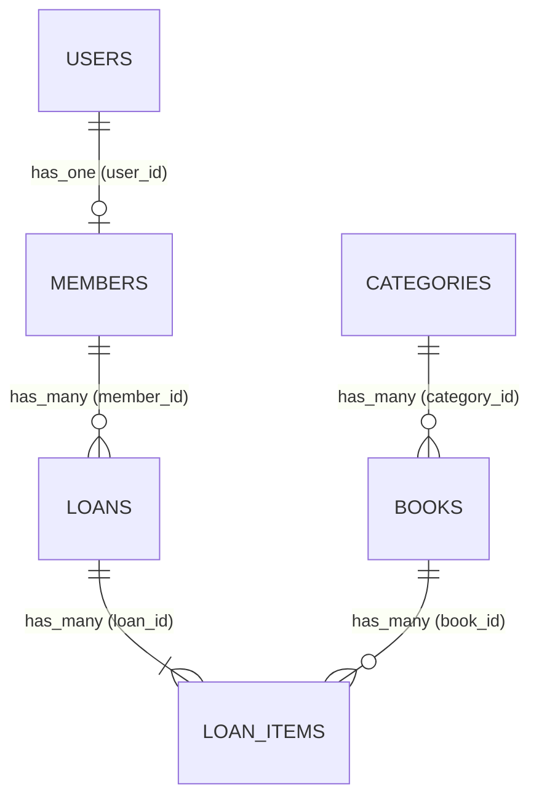

# Dokumen Perancangan Arsitektur: Self-Service Library System
**Final Project UAS - Workshop Pemrograman Framework**
*Tanggal Pengesahan: 12 November 2026*

---

## 1. Ringkasan Kebutuhan (*Understanding Summary*)
* **Tujuan**: Mengembangkan sistem informasi perpustakaan berbasis Laravel 12 menjadi sistem peminjaman mandiri (*Self-Service Borrowing*) interaktif dengan **Livewire v3 + Alpine.js + Tailwind CSS**.
* **Kebutuhan Evaluasi Dosen**:
  * Minimal 5 tabel domain yang berelasi nyata.
  * Transaksi memiliki siklus hidup (*lifecycle*) bisnis nyata: mutasi stok buku, validasi kuota pinjam, persetujuan petugas, dan denda keterlambatan otomatis.
* **Target Pengguna**:
  1. **Anggota / Mahasiswa**: Akses katalog real-time, pengajuan pinjaman buku mandiri, monitoring status & denda.
  2. **Petugas**: Pendaftaran akun anggota, verifikasi/persetujuan peminjaman, serta pemrosesan pengembalian buku dan denda.
  3. **Admin**: Hak akses penuh terhadap data master dan manajemen seluruh akun.

---

## 2. Kebutuhan Non-Fungsional (*Non-Functional Requirements*)
* **Performa**: Pencarian katalog buku responsif dengan *debounced model* 300ms tanpa me-reload browser.
* **Integritas Transaksi**: Pemotongan dan pemulihan stok buku wajib diapit dalam `DB::transaction()` serta memanfaatkan `lockForUpdate()` untuk mencegah *race condition*.
* **Keamanan & Otorisasi**: Role-based access control melalui Middleware Laravel (`admin`, `petugas`, `anggota`). Mahasiswa hanya dapat melihat dan mengajukan data pinjaman miliknya sendiri.

---

## 3. Arsitektur Data & Relasi Database

### Diagram Relasi Entitas (ERD)


### Rincian Perubahan Skema
1. **Tabel `users`**:
   - `role`: `'admin'`, `'petugas'`, `'anggota'`
2. **Tabel `members`**:
   - Menambahkan foreign key: `user_id` (nullable, cascade on delete)
3. **Tabel `loans`**:
   - Status diperbarui: `'diajukan'`, `'dipinjam'`, `'dikembalikan'`, `'ditolak'`
   - Kolom tambahan: `approved_by` (foreign key ke `users.id`), `approved_at` (timestamp), `fine_amount` (integer/decimal)
4. **Tabel `books`**:
   - Kolom `stock` (integer): berkurang $(-1)$ saat status `diajukan`, bertambah $(+1)$ saat `ditolak` atau `dikembalikan`.

---

## 4. Komponen Antarmuka & Interaktivitas

```text
app/Livewire/
├── BookCatalog.php          # Katalog buku interaktif untuk anggota
├── MyLoans.php              # Riwayat dan status pinjaman mahasiswa login
└── LoanApproval.php         # Panel petugas untuk approval & pengembalian
```

* **Livewire + Alpine.js**:
  * Pencarian dan filtering kategori buku di sisi server secara instan.
  * Modal konfirmasi peminjaman dikontrol secara cepat di sisi client oleh Alpine.js (`x-data="{ open: false }"`).
  * Validasi ketersediaan stok buku secara real-time.

---

## 5. Logika Transaksi & Aturan Bisnis
1. **Siklus Hidup Peminjaman**:
   $$\text{Katalog} \xrightarrow{\text{Pinjam}} \text{Diajukan (Stok -1)} \xrightarrow{\text{Approval Petugas}} \text{Dipinjam} \xrightarrow{\text{Pengembalian}} \text{Selesai (Stok +1)}$$
2. **Batas Kuota Pinjam**: Maksimal **3 buku aktif** per anggota (gabungan status `diajukan` dan `dipinjam`).
3. **Anti-Duplikasi**: Mahasiswa tidak dapat meminjam judul buku yang sama sebelum pinjaman sebelumnya selesai dikembalikan.
4. **Kalkulasi Denda Keterlambatan**:
   $$\text{Denda} = \max(0, \text{Hari Terlambat}) \times \text{Rp 5.000 / hari}$$
5. **Rollback Otomatis**: Jika pengajuan pinjaman ditolak petugas atau dibatalkan, stok buku otomatis dikembalikan $+1$.

---

## 6. Decision Log
1. **Pilihan Teknologi UI**: Memilih **Livewire v3 + Alpine.js + Tailwind CSS** (TALL Stack) karena native di Laravel, tidak membutuhkan server frontend terpisah, dan Alpine.js sudah ter-bundle otomatis di Livewire v3.
2. **Model Akun Anggota**: Akun login anggota dibuatkan secara terpusat oleh Petugas saat mendaftarkan anggota baru.
3. **Alur Peminjaman**: Memilih *Direct Borrowing via Modal* (Opsi 1) dibanding keranjang belanja untuk menjaga alur tetap sederhana, minim celah bug, dan lugas saat demo UAS.
4. **Tarif Denda**: Disepakati nominal denda adalah **Rp 5.000 / hari keterlambatan**.

---

## 7. Rencana Implementasi Bertahap (*Implementation Roadmap*)
Langkah-langkah eksekusi terstruktur:
1. **Langkah 1**: Instalasi dan konfigurasi package `livewire/livewire`.
2. **Langkah 2**: Pembuatan file migrasi database untuk kolom baru (`user_id` di `members`, kolom approval & status baru di `loans`).
3. **Langkah 3**: Pembaruan Model & Relasi Eloquent (`User`, `Member`, `Book`, `Loan`, `LoanItem`).
4. **Langkah 4**: Pembaruan `MemberController` dan form tambah anggota agar otomatis membuat akun login dengan role `anggota`.
5. **Langkah 5**: Pembuatan komponen Livewire `BookCatalog` (katalog buku, live search, modal pinjam Alpine.js, dan mutasi stok).
6. **Langkah 6**: Pembuatan komponen Livewire `MyLoans` (halaman riwayat pinjaman & kalkulasi estimasi denda untuk anggota).
7. **Langkah 7**: Pembuatan komponen Livewire `LoanApproval` (panel persetujuan, penolakan, dan pengembalian buku untuk petugas).
8. **Langkah 8**: Pengujian menyeluruh (*Feature Testing*) & verifikasi skenario transaksi.

